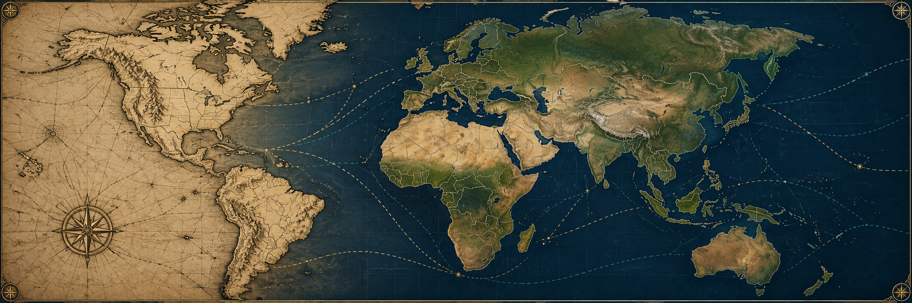

<p align="center">
  
</p>

<p align="center">
  
</p>

<h1 align="center">Pax Historia</h1>

<p align="center"><em>A local historical grand strategy sandbox, powered by AI.</em></p>

Choose a nation, shape its plans, and guide it through an evolving historical world. Pax Historia combines AI-generated events and advice with a persistent map, editable orders, diplomacy, and multi-turn campaigns.

> **Runs on your computer.** Game saves, provider settings, and API keys stay local.

| | |
|---|---|
| **Scenarios** | 1910, 1936, and 2010 |
| **Maps** | Interactive, province-based maps |
| **AI** | Local and cloud providers, plus custom OpenAI-compatible endpoints |
| **Requirements** | Node.js 20 or newer |

## Choose your starting point

| Scenario | Starting date | What it offers |
|---|---:|---|
| **Before the Great War** | 1 January 1910 | A decade of diplomacy and rising tension before a possible European war. |
| **World War II** *(default)* | 1 January 1936 | A geographic campaign across the tense pre-war world. |
| **Multipolar World** | 1 January 2010 | A modern world of competing powers and changing alliances. |

## What you can do

- Lead a nation through AI-generated events, briefings, diplomacy, and strategic advice.
- Write and revise orders before queuing them. Orders can shape diplomacy, movement, recruitment, and military campaigns.
- Follow campaigns across turns, review dated events, and play through their map changes. Skip ahead to important developments for the nation you control.
- Save campaigns locally and return to them later.
- Explore named provinces, cities, country borders, and formation positions on the map.

## Install and run

### Windows

Install [Node.js 20 or newer](https://nodejs.org/) once. Then double-click `server.bat` in the project folder. On its first run, the launcher installs the game dependencies automatically and starts the server; you do not need to enter setup commands in Command Prompt.

Open [http://localhost:3000](http://localhost:3000), choose a scenario, and configure an AI provider in **AI Settings**.

### macOS or Linux

Install Node.js 20 or newer, then install the gameplay dependencies and start the server:

```sh
cd backend
npm ci --omit=dev
node server.js
```

Then open [http://localhost:3000](http://localhost:3000).

Only one backend can use port 3000 at a time. If it is already occupied, use the game that is running or close its server before starting another one.

### Optional: shallow clone

For a smaller clone that skips older Git history and installs only gameplay dependencies:

```text
git clone --depth 1 https://github.com/francescodemunari/Local-Pax-Historia.git
cd Local-Pax-Historia/backend
npm ci --omit=dev
```

On Windows, double-click `server.bat` from the project folder. On macOS or Linux, follow the setup commands above.

## Configure AI

Open **AI Settings**, choose a provider, add a key if it is required, and select a model. **Fetch Models** can discover available models; you can also enter a model ID directly. Use **Test Connection**, then **Save Settings** to apply the configuration.

Built-in choices include local providers such as LM Studio, Ollama, llama.cpp, vLLM, LocalAI, and Jan; and cloud providers such as OpenAI, Gemini, Claude, OpenRouter, Groq, Together AI, Fireworks AI, DeepSeek, Mistral, xAI, Cerebras, and Hugging Face. Custom endpoints can use the OpenAI-compatible chat API.

Local providers need a running server and an available model. Cloud access depends on your provider account, and model discovery does not guarantee reliable game output. Saved secrets are reused only for the same provider and endpoint. See [AI provider details](docs/AI_PROVIDERS.md).

Optional startup defaults can be set in `backend/.env`: copy `backend/.env.example` and set `PORT`, `LLM_API_URL`, or `LLM_MODEL`. Saved AI settings take precedence.

## Gameplay scope

This is a playable prototype. Province shapes use modern Natural Earth administrative boundaries clipped to dated country borders, so historical internal divisions are approximate. Ground campaigns track movement and territorial control, while detailed tactical combat and sea or air transfers are not implemented. Numerical resource mechanics are disabled; capacity and constraints are described through events. Detailed historical economies and leadership still need research, and campaign endings are deferred.

For current supported gameplay, verification, and known limits, see [playability scope](docs/PLAYABILITY.md).

## Maps and existing saves

New campaigns use province maps. Older geographic-sector saves load their archived assets, and existing 1914 campaigns keep their original date and map. These compatibility options are hidden from new-game selection.

The illustrated WWII legacy map is no longer playable in this version. Its save files are left untouched and are not converted; use an older checkout to play them. Map sources, historical limits, and rebuild instructions are in [Geographic maps](docs/GEOGRAPHIC_MAPS.md). Credits are also available in the game.

Map-source downloads and editable geography build outputs are excluded from Git. The game-ready province data, renderer maps, and old-save compatibility assets are included. Python and map downloads are only needed to rebuild geography, not to play.

## Development

From `backend`, install the development dependencies and run the checks:

```text
npm ci
npm test
```

The separate browser regression suite can be run with `npm run test:geographic-browser`. Rebuild geography with `npm run fetch:geography` and `npm run build:geography`; install `scripts/geography-requirements.txt` first.

```text
backend/                 API, game engine, and provider adapters
frontend/                Game UI, map renderer, and compiled maps
data/geography/          Pinned sources, dated builds, and control overlays
data/scenarios/          Versioned scenario manifests and runtime assets
data/saves/              Local campaigns (ignored by Git)
scripts/                 Build tools and regression checks
docs/                    Gameplay, design, and maintenance notes
```

To add a scenario, start with `data/scenarios/templates/manifest.example.json`. Each scenario needs its own date, map, nations, cities, renderer, context, and unit catalog. See [scenario extension](docs/SCENARIO_EXTENSION.md), [map readiness](docs/MAP_READINESS.md), and [release readiness](docs/RELEASE_READINESS.md).

## Project notes

- [Campaign rules](docs/CAMPAIGNS.md)
- [AI reliability](docs/AI_RELIABILITY.md)
- [Military operation contract](docs/OPERATION_CONTRACT.md)
- [Map performance](docs/MAP_PERFORMANCE.md)
- [Leadership and portraits](docs/LEADERSHIP_AND_PORTRAITS.md)
- [Maintenance and cleanup](docs/CLEANUP.md)

## Sources and licensing

This personal project is separate from the original Pax Historia product. Geographic bundles adapt [CShapes 2.0](https://icr.ethz.ch/data/cshapes/) under **CC BY-NC-SA 4.0**, including its noncommercial restriction. Natural Earth inputs are public domain. Read the [source attribution and licensing notes](docs/GEOGRAPHIC_MAPS.md#source-data-and-licensing) before redistribution.
